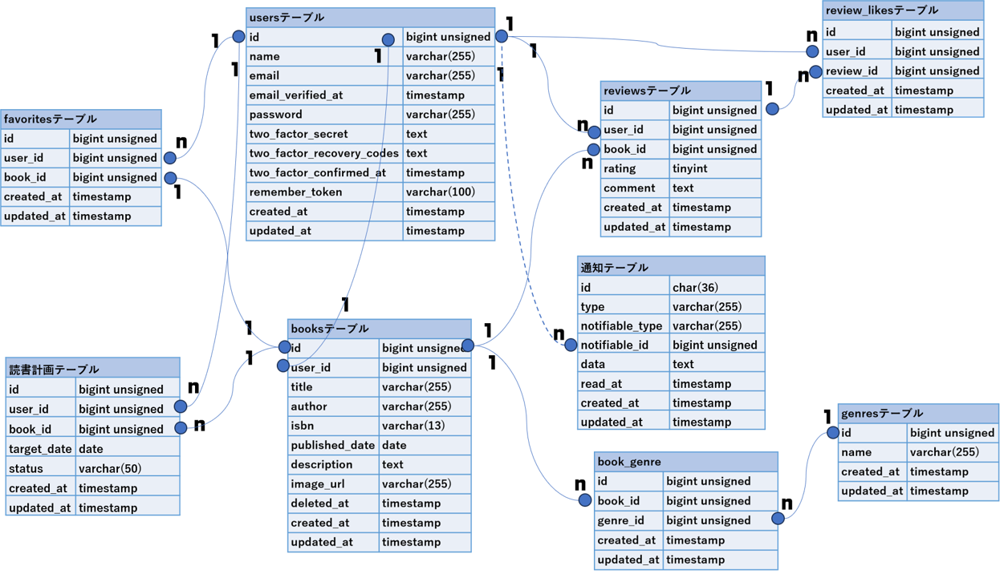

# BookShelf 書籍レビューアプリ

## 概要

COACHTECHの模擬案件課題である「BookShelf（書籍レビューアプリ）」のWebアプリケーションです。  
ユーザーは書籍の登録・閲覧・編集・削除やレビュー投稿、お気に入り登録、レビューへの「いいね」、平均評価に基づくランキング機能などを利用できます。  
また、キーワード・ジャンル・ソートによる高度な検索、Google Books API（ISBN-13）連携による書籍情報自動取得、マイ読書レポート（統計ダッシュボード）、読書計画機能・リマインダー通知（日次バッチ配信）、および Sanctum トークン認証を備えた外部向け公開 API を提供しています。

## 使用技術

- **OS**: Dockerが動作する任意のOS
- **PHP**: 8.5
- **Laravel**: 10.x
- **データベース**: MySQL 8.4
- **サーバー**: Nginx
- **フロントエンド**: Vite, Tailwind CSS ^3.4.0, @tailwindcss/forms, Alpine.js
- **認証系**: Laravel Fortify, Laravel Sanctum
- **開発ツール**: Docker, Laravel Sail, phpMyAdmin

## ER図



## 環境構築手順

1. リポジトリのクローン

- 本リポジトリをローカル環境にクローンします。
  ```bash
  git clone https://github.com/mitsuaki-mi6/bookshelf-app
  cd ~/bookshelf-app
  ```

2. 環境変数ファイル (.env) の作成と設定

- `.env.example` をコピーして `.env` ファイルを作成します。
  ```bash
  cp .env.example .env
  ```
- `.env` ファイルを開き、データベース接続情報が以下と一致していることを確認・設定します。
  ```env
  DB_CONNECTION=mysql
  DB_HOST=mysql
  DB_PORT=3306
  DB_DATABASE=laravel
  DB_USERNAME=sail
  DB_PASSWORD=password
  ```

3. PHP依存パッケージ（Composer）のインストール

- Dockerコンテナを使用して、必要なパッケージをインストールします。
  ```bash
  docker run --rm \
      -u "$(id -u):$(id -g)" \
      -v "$(pwd):/var/www/html" \
      -w /var/www/html \
      -e COMPOSER_CACHE_DIR=/tmp/composer_cache \
      laravelsail/php82-composer:latest \
      composer install
  ```

4. phpMyAdminの追加

- `compose.yaml` を開き、`mysql` サービスの後に以下の設定を追加します。
  ```yaml
  phpmyadmin:
    image: "phpmyadmin:latest"
    ports:
      - "${FORWARD_PHPMYADMIN_PORT:-8080}:80"
    environment:
      PMA_HOST: mysql
      PMA_USER: "${DB_USERNAME}"
      PMA_PASSWORD: "${DB_PASSWORD}"
    networks:
      - sail
    depends_on:
      - mysql
  ```

5. Laravel Sailの起動とエイリアス設定  
   (1) Sailの起動

   ```bash
   ./vendor/bin/sail up -d
   ```

   (2) エイリアスを設定して 'sail' だけでコマンドを実行できるようにする

   ```bash
   echo "alias sail='[ -f sail ] && bash sail || bash vendor/bin/sail'" >> ~/.bashrc
   exec $SHELL
   ```

6. アプリケーションキーの生成

   ```bash
   sail artisan key:generate
   ```

7. データベースのマイグレーションと初期データ投入

- 以下のコマンドでテーブルを作成し、初期データ（ユーザー、ジャンル、書籍、レビュー等）を投入します。
  ```bash
  sail artisan migrate --seed
  ```

8. フロントエンドのセットアップ (Vite & Tailwind CSS)
   (1) NPM依存パッケージおよび Alpine.js のインストール

   ```bash
   sail npm install
   sail npm install alpinejs
   ```

   (2) Tailwind CSS および `@tailwindcss/forms` プラグインのインストール

   ```bash
   sail npm install -D tailwindcss@^3.4.0 @tailwindcss/forms postcss autoprefixer
   ```

   (3) 設定ファイルの生成と Tailwind CSS のパス設定
   - `tailwind.config.js` を開き、`plugins` 配下に `require('@tailwindcss/forms')` を追加します。

   (4) 開発用サーバーの起動

   ```bash
   sail npm run dev
   ```

   ※ Vite開発サーバーは開発中は常に起動したままにしてください。

## バッチ処理（タスクスケジュール）の実行

- 本アプリケーションでは、読書計画のリマインダー通知などのためにLaravelのタスクスケジュール機能（cronバッチ）を使用しています。  
ローカル環境（Docker / Sail）で手動でバッチをテスト実行する場合は、以下のコマンドを使用します。
   ```bash
   sail artisan schedule:run
   ```
- また、常時バックグラウンドでスケジューラーを稼働させたい場合は、以下のコマンドを実行します。
   ```bash
   sail artisan schedule:work
   ```


## テストの実行方法

- 本アプリケーションのPHPUnitテストを実行する場合は、以下のコマンドを使用します。
  ```bash
  sail artisan test --coverage
  ```

## 開発環境URL

- ローカル環境: `http://localhost`
- phpMyAdmin（データベース確認用）: `http://localhost:8080`


## ルーティング一覧

### 1. Web ルーティング（画面・処理用）

| メソッド | パス                                 | アクション名 / 概要                          | 認証 / 認可      |
| :------- | :----------------------------------- | :------------------------------------------- | :--------------- |
| GET      | `/` または `/books`                  | `books.index` （書籍一覧・検索・ソート）     | 公開             |
| GET      | `/books/create`                      | `books.create` （書籍登録画面）              | 認証必須         |
| POST     | `/books`                             | `books.store` （書籍登録処理）               | 認証必須         |
| GET      | `/books/isbn/{isbn}`                 | `books.isbn` （Google Books API ISBN検索）   | 認証必須         |
| GET      | `/books/{book}`                      | `books.show` （書籍詳細画面）                | 公開             |
| GET      | `/books/{book}/edit`                 | `books.edit` （書籍編集画面）                | 認証＋作成者本人 |
| PUT      | `/books/{book}`                      | `books.update` （書籍更新処理）              | 認証＋作成者本人 |
| DELETE   | `/books/{book}`                      | `books.destroy` （書籍削除処理）             | 認証＋作成者本人 |
| POST     | `/books/{book}/favorites`            | `favorites.store` （お気に入りトグル）       | 認証必須         |
| GET      | `/favorites`                         | `favorites.index` （お気に入り一覧画面）     | 認証必須         |
| POST     | `/books/{book}/reviews`              | `reviews.store` （レビュー投稿処理）         | 認証必須         |
| GET      | `/reviews/{review}/edit`             | `reviews.edit` （レビュー編集画面）          | 認証＋投稿者本人 |
| PUT      | `/reviews/{review}`                  | `reviews.update` （レビュー更新処理）        | 認証＋投稿者本人 |
| DELETE   | `/reviews/{review}`                  | `reviews.destroy` （レビュー削除処理）       | 認証＋投稿者本人 |
| POST     | `/reviews/{review}/like`             | `reviews.like` （レビューいいねトグル）      | 認証必須         |
| GET      | `/genres`                            | `genres.index` （ジャンル一覧画面）          | 認証必須         |
| GET      | `/genres/create`                     | `genres.create` （ジャンル登録画面）         | 認証必須         |
| POST     | `/genres`                            | `genres.store` （ジャンル登録処理）          | 認証必須         |
| GET      | `/genres/{genre}`                    | `genres.show` （ジャンル詳細画面）           | 認証必須         |
| GET      | `/genres/{genre}/edit`               | `genres.edit` （ジャンル編集画面）           | 認証必須         |
| PUT      | `/genres/{genre}`                    | `genres.update` （ジャンル更新処理）         | 認証必須         |
| DELETE   | `/genres/{genre}`                    | `genres.destroy` （ジャンル削除処理）        | 認証必須         |
| GET      | `/ranking`                           | `ranking.index` （評価ランキング画面）       | 公開             |
| GET      | `/reports`                           | `reports.index` （マイ読書レポート画面）     | 認証必須         |
| GET      | `/reading-plans`                     | `reading_plans.index` （読書計画一覧画面）   | 認証必須         |
| GET      | `/reading-plans/create`              | `reading_plans.create` （読書計画作成画面）  | 認証必須         |
| POST     | `/reading-plans`                     | `reading_plans.store` （読書計画作成処理）   | 認証必須         |
| GET      | `/reading-plans/{plan}/edit`         | `reading_plans.edit` （読書計画編集画面）    | 認証＋所有者本人 |
| PUT      | `/reading-plans/{plan}`              | `reading_plans.update` （読書計画更新処理）  | 認証＋所有者本人 |
| DELETE   | `/reading-plans/{plan}`              | `reading_plans.destroy` （読書計画削除処理） | 認証＋所有者本人 |
| GET      | `/notifications`                     | `notifications.index` （通知一覧画面）       | 認証必須         |
| POST     | `/notifications/{notification}/read` | `notifications.read` （通知既読化処理）      | 認証必須         |


### 2. API エンドポイント一覧 (`/api/v1/`)

| メソッド | パス                   | 概要                                                     | 認証（ Sanctum ）            |
| :------- | :--------------------- | :------------------------------------------------------- | :--------------------------- |
| GET      | `/api/v1/books`        | 書籍一覧取得（検索・ジャンル絞り込み・ページネーション） | 不要                         |
| GET      | `/api/v1/books/{book}` | 書籍詳細取得                                             | 不要                         |
| POST     | `/api/v1/books`        | 書籍新規登録                                             | **Sanctum 必須**             |
| PUT      | `/api/v1/books/{book}` | 書籍更新                                                 | **Sanctum 必須＋所有者のみ** |
| DELETE   | `/api/v1/books/{book}` | 書籍削除                                                 | **Sanctum 必須＋所有者のみ** |

## 作成者

中村満明
